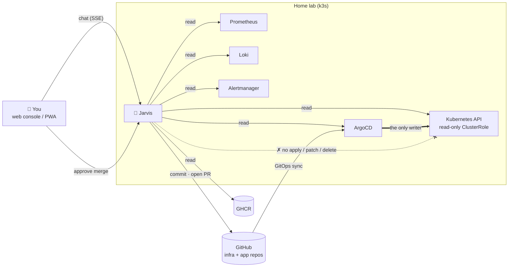
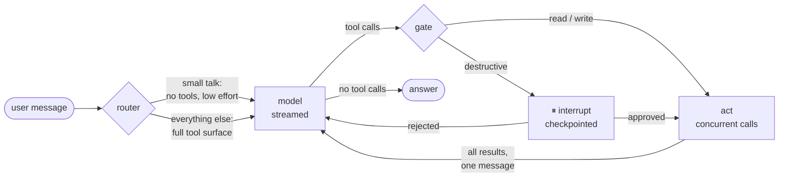
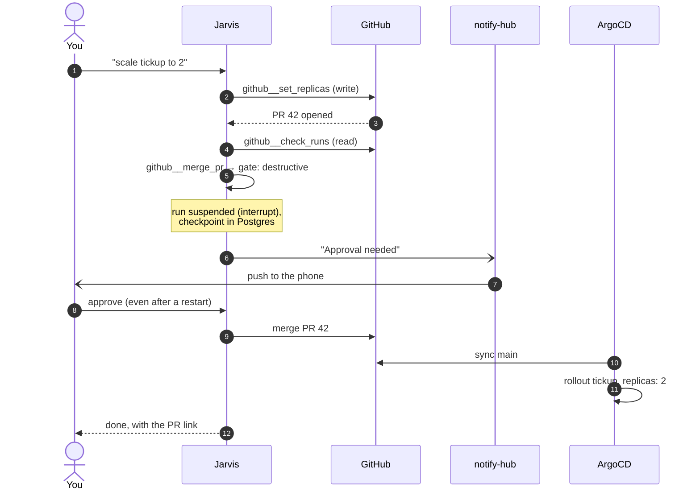
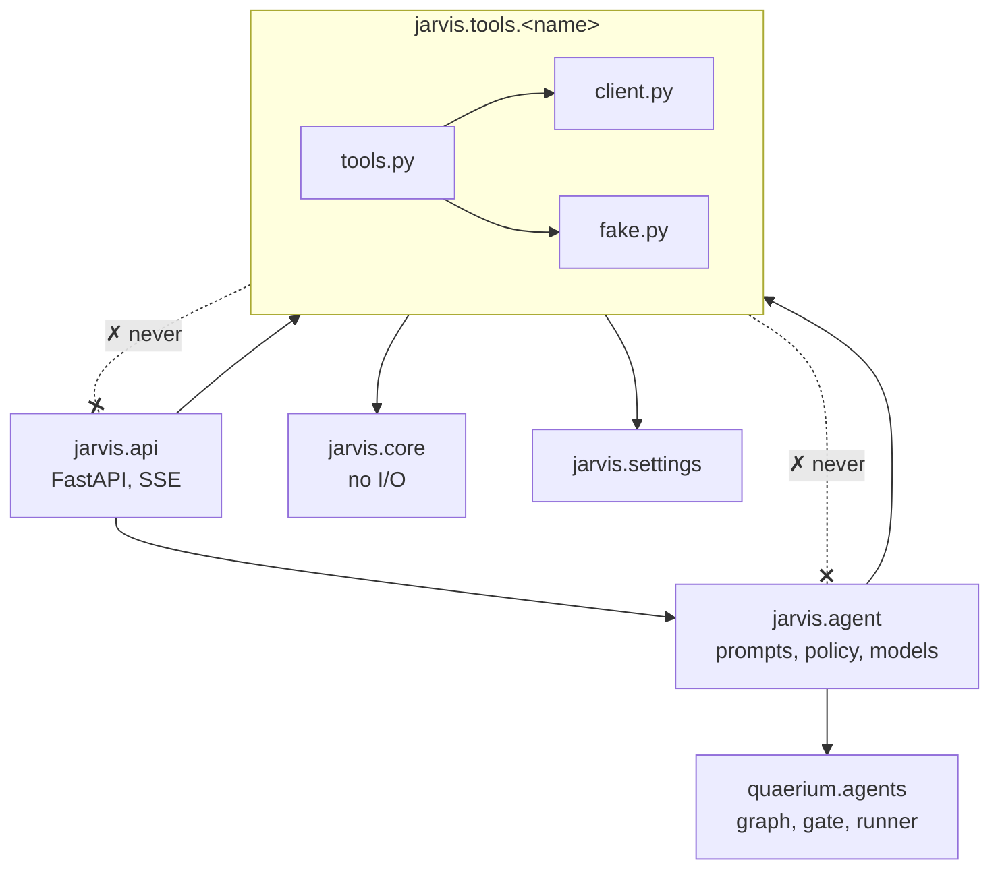
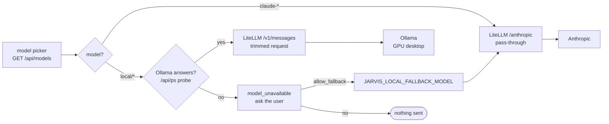
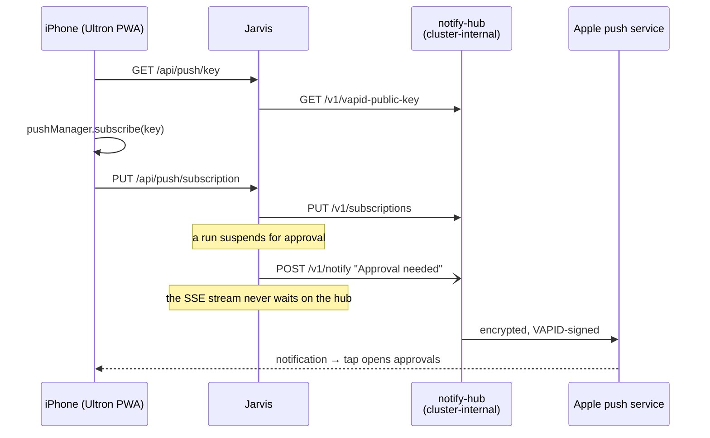
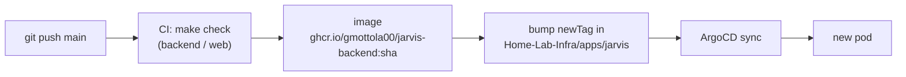

<div align="center">

# 🤖 Ultron Home Lab

**An AI agent that operates your home lab, without ever touching the cluster.**

[](https://github.com/gmottola00/Jarvis/actions/workflows/backend.yml)
[](https://github.com/gmottola00/Jarvis/actions/workflows/web.yml)
[](LICENSE)


[Quick start](#-quick-start) · [How it works](#-how-it-works) · [Add a capability](#-adding-a-capability) · [Configuration](#-configuration) · [In my home lab](#-in-my-home-lab) · [Contributing](CONTRIBUTING.md)

</div>

---

Jarvis is **P0 — "hands, no face"**: a text-only agent driven from a web console
(and installable on your phone). Ask it why a pod is crashing, what changed in
ArgoCD, or to scale an app, and it reads Kubernetes, Prometheus, Loki, ArgoCD and
GitHub to answer.

> **Jarvis has no `kubectl apply` in its hands.** It writes commits and opens pull
> requests against your infra repo and app repos; ArgoCD stays the only thing
> that changes the cluster, so every action Jarvis takes is diffable and revertible.

That is not a guideline, it is the architecture. There is no apply, patch, delete
or scale tool anywhere in this codebase, and a test asserts there never is.



## ✨ Highlights

- 🔒 **GitOps-only writes.** Changes are commits and PRs; merging is gated on a human.
- 🧰 **Pluggable capabilities.** Kubernetes, ArgoCD, GHCR, GitHub, Prometheus, Loki, Alertmanager.
- 🧪 **Runs offline.** `JARVIS_FAKE_TOOLS=true` serves every tool from fixtures: no cluster, token or API key needed.
- 📱 **Phone-ready PWA** with push notifications for pending approvals.
- 🔀 **Model gateway.** Claude, plus local models through a LiteLLM proxy; falls back to Claude only with your consent.
- ✅ **Tested without an LLM.** The whole agent graph is driven by scripted turns.

> [!WARNING]
> The console has **no built-in authentication**. Run it behind a private network
> (e.g. Tailscale) and never expose it to the public internet. See [SECURITY.md](SECURITY.md).

---

## 📦 Prerequisites

- **Python 3.12** and [uv](https://docs.astral.sh/uv/) — the backend.
- **Node 22** — only to build the dashboard. Install it with
  [nvm](https://github.com/nvm-sh/nvm) or your package manager.
- **Docker** — only for `make up`. The backend runs fine without it.

`web/dist/` is already built, so `make run-api` serves the dashboard on :8100
before Node is installed. Node is needed to change the dashboard.

## 🚀 Quick start

Nothing below needs a cluster, a token, or even an API key to run.

```bash
make setup        # venv + dependencies + dashboard + .env
make run          # builds the dashboard, serves everything on :8100
```

Open <http://localhost:8100>. With `JARVIS_FAKE_TOOLS=true` (the default in
`.env.example`) every capability is served from fixtures that mirror the real lab,
so the dashboard populates and the deploy flow can be rehearsed offline.

Add `ANTHROPIC_API_KEY` to `.env` to enable chat.

**While developing**, two processes are nicer than one:

```bash
make run-api      # :8100, reloading
make run-web      # :5173, hot module reload, proxies /api to :8100
```

**The full stack**, with Postgres and Redis so suspended approvals survive a
restart:

```bash
make up           # dashboard on :8080
```

---

## 🧠 How it works

The agent loop is [`quaerium.agents`](https://github.com/gmottola00/quaerium)
(Quaerium ≥ 0.4), a reusable agent kernel. Jarvis brings the
capabilities, the prompts, the router's vocabulary, the policy texts, the model
catalog and the gateway. To work on both at once: `make quaerium-dev`, then
`UV_NO_SYNC=1 make check`.



- **router** — small talk gets no tools and low effort; everything else gets the
  full surface.
- **model** — Claude Opus 5 with adaptive thinking, streamed. The Anthropic SDK
  is confined to the kernel's `AnthropicLLM`; everything else talks to a
  protocol, which is how the whole graph is tested without an API key.
- **gate** — the one place a human is asked. Reads and writes pass; destructive
  calls suspend the run via LangGraph's `interrupt`, checkpointed to Postgres.
- **act** — cleared calls run concurrently and every result comes back in a
  single message.

The policy:

| risk | meaning | what happens |
|---|---|---|
| `read` | no side effects | runs immediately |
| `write` | commit or pull request — never the cluster | runs immediately |
| `destructive` | hard to reverse | suspends and asks |

`github__merge_pr` is destructive on purpose. Merging is what ships; that gate is never automated.

What "scale tickup to 2" looks like end to end:



---

## 🧩 Adding a capability

**This is where Jarvis grows.** Three steps, and nothing else changes — not the
graph, not the gate, not the API, not the dashboard.

```
src/jarvis/tools/<name>/
├── client.py    # typed async client; reads its token from Settings
├── fake.py      # same surface, static fixtures
├── tools.py     # the @tool functions + a ClientProvider
└── __init__.py  # exports TOOLS and provider
```

```python
@tool(namespace="home", risk=RiskLevel.WRITE)
async def wake(host: str) -> str:
    """Send a Wake-on-LAN packet.

    Args:
        host: The machine to wake, e.g. "desktop-5080".
    """
    return await provider.get().wol(host)
```

The JSON Schema is derived from the signature and the docstring, so that
`Args:` block becomes the parameter description the model reads. Then add the
module to `CAPABILITIES` in `src/jarvis/tools/__init__.py`. Done.

A capability may import from `jarvis.core`, `jarvis.settings` and `jarvis.tools` —
never from `jarvis.agent` or `jarvis.api`. That is what keeps lifting one out into
a standalone MCP server an adapter rather than a rewrite.



### What ships today

| namespace | tools | risk |
|---|---|---|
| `k8s` | `list_nodes` `list_pods` `get_logs` `list_events` `rollout_status` | read |
| `argocd` | `list_apps` `app_health` `app_diff` | read |
| `argocd` | `hard_refresh` | destructive |
| `ghcr` | `list_tags` `newest_green_tag` | read |
| `github` | `read_file` `list_prs` `check_runs` | read |
| `github` | `create_branch` `commit_file` `open_pr` | write |
| `github` | `set_replicas` (PR that sets `replicas` in the kustomization; apps in `JARVIS_REPLICAS_APPS` only) | write |
| `github` | `merge_pr` | destructive |
| `prometheus` | `query` `query_range` `pod_resources` `targets_down` | read |
| `loki` | `search` `query` | read |
| `alertmanager` | `list_alerts` | read |

---

## 🗂️ Layout

```
src/jarvis/
├── settings.py        pydantic-settings; every credential lives here
├── exceptions.py      JarvisError, below the kernel's AgentError
├── core/              dashboard value types, the console's log logic, kustomize edits — no I/O
├── tools/             one folder per capability
├── gateway/           LiteLLM spend, failures and latency for the gateway view
├── notify/            notify-hub client: notify() never raises, and the approval push
├── agent/             prompts, router vocabulary, policy texts, model catalog, playbooks
└── api/               FastAPI: lifespan, SSE chat, lab overview push (approvals and runs from quaerium)

web/src/
├── lib/               types mirroring quaerium.agents.types and core/types.py, the SSE parser, REST calls
├── components/        chat, approval dialog, lab panel, run timeline
└── pages/Dashboard.tsx
```

---

## ⚙️ Configuration

Everything is `JARVIS_`-prefixed except `ANTHROPIC_API_KEY`. See `.env.example`.

Jarvis starts degraded rather than refusing to boot:

| missing | consequence |
|---|---|
| `ANTHROPIC_API_KEY` | chat says why; the dashboard still works |
| `JARVIS_DATABASE_URL` | in-memory checkpointer — a restart forgets pending approvals |
| `JARVIS_REDIS_URL` | in-process session history |
| capability tokens | that capability's tools return an error naming the variable to set |
| `JARVIS_LLM_GATEWAY_URL` | Claude only, straight to Anthropic; the model picker is hidden |
| `JARVIS_OLLAMA_URL` | local models always shown as available; the gateway's fallback still covers a dead GPU |
| `JARVIS_PROMETHEUS_URL` | `prometheus__*` tools return an error naming the variable; the rest of the agent is unaffected |
| `JARVIS_LOKI_URL` | `loki__*` tools likewise; `k8s__get_logs` still reads live containers |
| `JARVIS_ALERTMANAGER_URL` | the alerts page shows an error card; the dashboard's alert count is simply left out |
| `JARVIS_NOTIFY_URL`, `NOTIFY_TOKEN` | push notifications off; the bell says why |
| `JARVIS_LITELLM_DB_URL` | Settings shows only Jarvis's own budget; no per-app spend, failures or latency, no gateway problems in Status |

### Models and the LLM gateway

With `JARVIS_LLM_GATEWAY_URL` pointing at a LiteLLM proxy, every model call goes
through it and `ANTHROPIC_API_KEY` holds the proxy's virtual key, not the real
one. The chat gets a model picker fed by `GET /api/models`, which is whatever
that key may call:

- `claude-*` go through the proxy's Anthropic pass-through, so adaptive
  thinking, effort and the refusal fallback arrive untouched;
- `local/*` (Ollama on the GPU desktop) go through the proxy's `/v1/messages`,
  with a trimmed request. Their thinking is streamed but not kept in history,
  since a later Claude turn would reject an unsigned thinking block.

While the desktop is off, `local/*` show as offline. A message sent to one
never silently lands on Claude: the chat answers `model_unavailable`, asks
whether to use `JARVIS_LOCAL_FALLBACK_MODEL` (default `claude-haiku-4-5`)
instead, and only then resends with `allow_fallback`. No timeout is waited on —
Jarvis probes Ollama itself. The answering model is shown under each reply. In
the cluster the proxy is `apps/litellm` in Home-Lab-Infra; locally,
`docker compose --profile gateway up`.



### On the phone and notifications

Added to the iPhone Home Screen (Share → Add to Home Screen) Jarvis opens as
**Ultron**, full screen, with its own icon and launch screen. `web/public/sw.js`
keeps the shell so it never opens blank, and never touches `/api`. Icons and
launch screens are rendered by `npm run pwa-assets` (needs `google-chrome`).

Push goes through notify-hub, a small lab service that holds the
VAPID key and the subscribed phones; the phone subscribes via Jarvis
(`/api/push/*`), never to the hub, which is cluster-internal.



- **Bell** in the phone top bar (or "notifications" in the sidebar): turn on, off,
  send a test. On iPhone it works only from the Home Screen app.
- **A run waiting for approval** pushes "Approval needed"; the tap opens
  Jarvis → approvals. In the background: the stream never waits on the hub.
- **From code:** `await svc.notifier.notify("Title", "Body", url="/#status", tag="...")`.
  It never raises: a hub that does not answer logs `notify.failed` and returns `None`.

---

## 🧪 Testing

```bash
make check        # black, isort, ruff, mypy --strict, pytest
make smoke-web    # the browser's SSE client, against a live backend
```

The graph tests drive a `ScriptedLLM` — a list of turns replayed in order — so
every assertion is about what the loop does, not about what a language model
happened to say. The API tests run the real ASGI app: routers, SSE encoding,
runner, graph, gate and checkpointer, all together.

`make smoke-web` covers the one seam Python cannot reach: the wire format as the
browser parses it. It earned its place — it caught a CRLF framing bug that every
Python test missed, because httpx normalises line endings and `fetch` does not.

---

## 🛣️ Roadmap

Planned phases:

- **P1 — voice.** Push-to-talk → Pipecat + whisper + Piper.
- **P2 — GPU on demand.** The desktop joins as a k3s agent, woken by WoL.
- **P3 — vision and gesture.**
- **P4 — autonomy.** `mcp-coder`, preview namespaces per PR.

## 🚢 In my home lab

Jarvis runs on the same single-node k3s cluster it operates, managed from
[**Home-Lab-Infra**](https://github.com/gmottola00/Home-Lab-Infra) (manifests in
`apps/jarvis`). It is reachable only over the tailnet (`jarvis.<tailnet>.ts.net`),
reads the cluster through a `jarvis` ServiceAccount bound to the read-only
ClusterRole `jarvis-reader` (no access to Secrets), and calls models through the
lab's LiteLLM gateway with its own budgeted virtual key.



Nothing is applied by hand — the same rule Jarvis itself follows.

---

## 🤝 Contributing

Issues and pull requests are welcome. Read [CONTRIBUTING.md](CONTRIBUTING.md) first,
and report vulnerabilities privately as described in [SECURITY.md](SECURITY.md).

## 📄 License

[MIT](LICENSE) © Gianmarco Mottola
